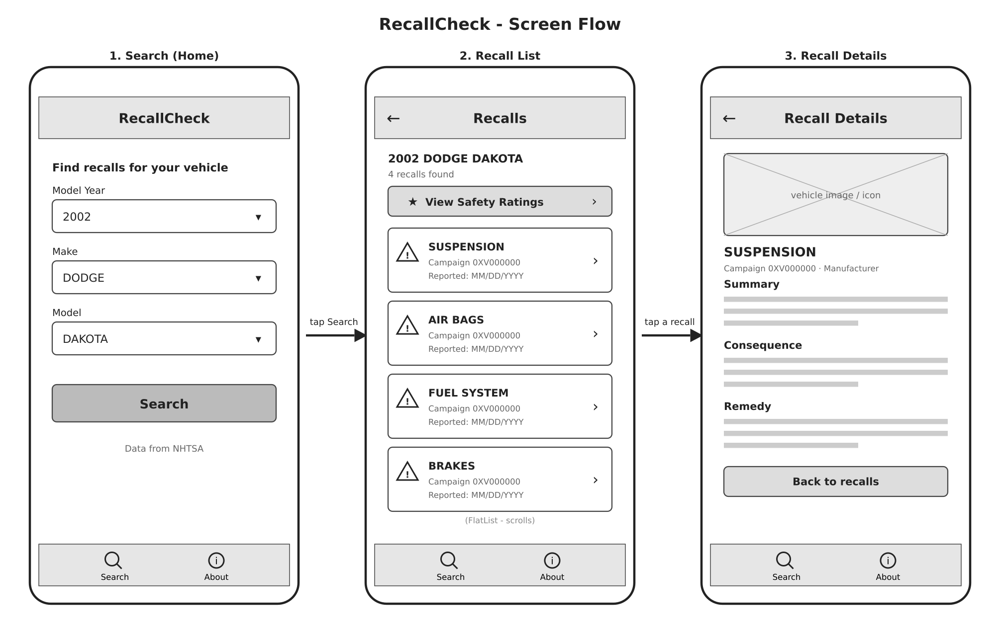

# RecallCheck

A React Native (Expo) app that looks up vehicle safety recalls and crash-test ratings by year, make and model. All data comes live from the NHTSA API. Nothing is stored locally.

## Project Overview

- Search for a vehicle by model year, make and model
- Browse a list of recalls for that vehicle
- Tap a recall to see the summary, consequence and remedy
- View NHTSA 5-star safety ratings

## Setup

1. Install [Node.js](https://nodejs.org) and the Expo Go app on your phone
2. Clone the repo:
   ```
   git clone https://github.com/DustinLambert05/RecallCheck.git
   cd RecallCheck
   ```
3. Install packages:
   ```
   npm install
   ```
4. Start the app:
   ```
   npx expo start
   ```
5. Scan the QR code with Expo Go

## API Used

NHTSA (National Highway Traffic Safety Administration) API — `https://api.nhtsa.gov`. Free, no API key needed.

- `/products/vehicle/makes` and `/products/vehicle/models` — makes and models for the search pickers
- `/recalls/recallsByVehicle` — recalls for a vehicle
- `/SafetyRatings` — crash-test star ratings

## Team Contributions

| Member | Contribution |
| --- | --- |
| Dustin Lambert | All design, development and documentation |

## Screenshots / Screen Flow

Wireframes are in the `wireframes/` folder. Screenshots will be added as the app is built.


